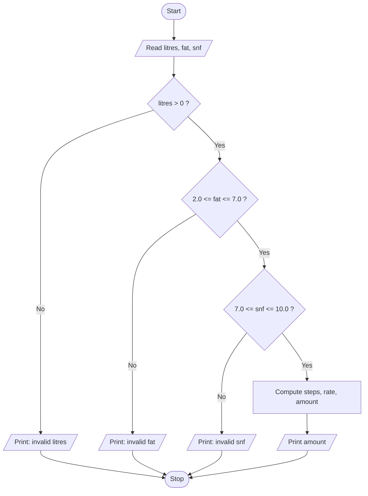

# Task 8 - Pseudocode, flowchart and hand trace

> NOTE: your faculty mentions the *SIMATS Engineering – Standard for Algorithmic Pseudocode*.
> Keep the structure below but check the keywords (INPUT/OUTPUT/IF/ENDIF ...) against the
> official standard sheet given in class and rename them if it differs.

## Steps of algorithmic problem solving
1. **Understand** – inputs (litres, fat, snf), output (amount), rules (ranges), ten-day total.
2. **Plan** – pseudocode + flowchart + hand trace (this file).
3. **Write** – `algorithm.py`.
4. **Test** – compare the program's output with the hand trace.

## Pseudocode A - one payment

```
ALGORITHM OnePayment
INPUT : litres, fat, snf
OUTPUT: amount (Rs, 2 decimals) or an error message
CONSTANTS: BASE_RATE = 30.00, FAT_STEP_VALUE = 0.40, SNF_STEP_VALUE = 0.30

BEGIN
    IF litres <= 0 THEN
        OUTPUT "invalid litres"; STOP
    ENDIF
    IF fat < 2.0 OR fat > 7.0 THEN
        OUTPUT "invalid fat"; STOP
    ENDIF
    IF snf < 7.0 OR snf > 10.0 THEN
        OUTPUT "invalid snf"; STOP
    ENDIF
    fatSteps  <- ROUND((fat - 3.5) / 0.1)
    snfSteps  <- ROUND((snf - 8.5) / 0.1)
    rate      <- BASE_RATE + fatSteps * FAT_STEP_VALUE + snfSteps * SNF_STEP_VALUE
    amount    <- ROUND(litres * rate, 2)
    OUTPUT amount
END
```

## Pseudocode B - ten-day total for one farmer (running total)

```
ALGORITHM TenDayTotal
INPUT : n entries, each (litres, fat, snf)
OUTPUT: total
BEGIN
    total <- 0
    FOR i <- 1 TO n DO
        READ litres, fat, snf
        IF entry is valid THEN
            total <- total + OnePayment(litres, fat, snf)
        ELSE
            OUTPUT "entry i rejected"
        ENDIF
    ENDFOR
    OUTPUT total
END
```

## Flowchart - validate one entry (GitHub renders this Mermaid diagram)



## Hand trace (three entries, running total)

| Step | litres | fat | snf | fat steps | snf steps | rate | amount | running total |
|------|--------|-----|-----|-----------|-----------|------|--------|---------------|
| start | - | - | - | - | - | - | - | 0.00 |
| 1 | 10 | 3.5 | 8.5 | 0 | 0 | 30 + 0 + 0 = 30.00 | 10 x 30.00 = 300.00 | 300.00 |
| 2 | 8.5 | 4.2 | 8.7 | +7 | +2 | 30 + 2.80 + 0.60 = 33.40 | 8.5 x 33.40 = 283.90 | 583.90 |
| 3 | 12 | 3.1 | 8.3 | -4 | -2 | 30 - 1.60 - 0.60 = 27.80 | 12 x 27.80 = 333.60 | 917.50 |

**Expected ten-day total = Rs 917.50** (the program in `algorithm.py` must print the same).
